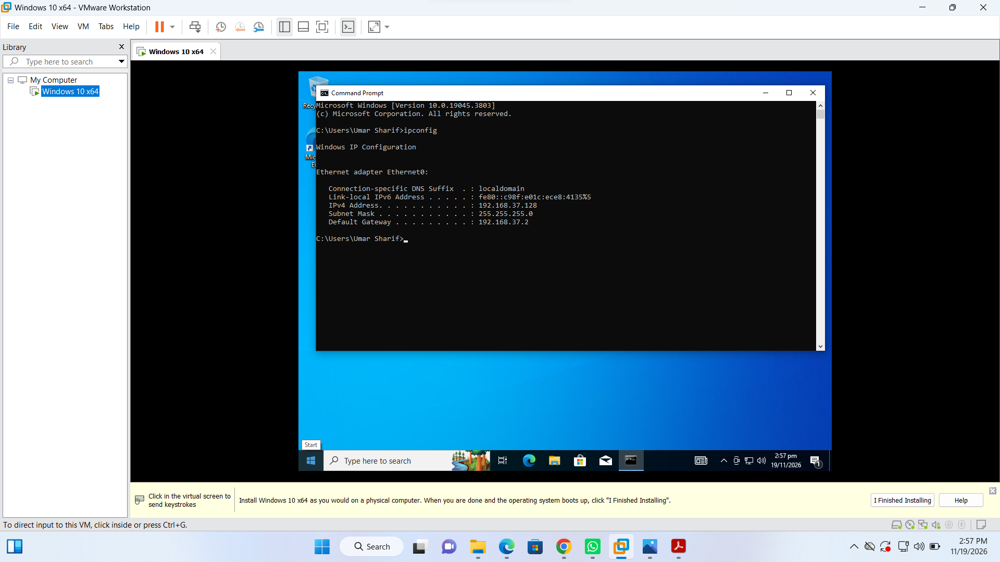

# Module 01 – Task 01: Building the Enterprise Virtual Lab

**IT Simplera Solutions | System Administration & IT Infrastructure Services | Internship Batch-02 (2026)**

| | |
|---|---|
| **Name** | Umar Sharif |
| **Registration No.** | ITSSA-B02-1066 |
| **Domain** | System Administration and IT Infrastructure Services |
| **Submitted To** | Tahir Zaman, Team Lead |

## Overview

This repository contains my work for Module 01, Task 01: building a virtual lab on a single computer using a Type-2 hypervisor, deploying a Windows 10 virtual machine, and practising manual disk partitioning with the DiskPart command-line tool.

📄 **Full report (PDF):** [Umar_Sharif_ITSSA-B02-1066_Module01_Task01_Report.pdf](Umar_Sharif_ITSSA-B02-1066_Module01_Task01_Report.pdf)

## What I Built

| Parameter | Configuration |
|---|---|
| Hypervisor | VMware Workstation Pro 26H1 |
| Guest OS | Windows 10 Pro 64-bit (Build 19045) |
| CPU | 2 cores |
| Memory | 4 GB RAM |
| Storage | 60 GB virtual disk |
| Networking | NAT (VMnet8) |
| Firmware | UEFI |

## Tasks Completed

- **Part A – Hypervisor provisioning:** Installed VMware Workstation Pro and verified the VMnet1 and VMnet8 virtual network adapters on the host.
- **Part B – Virtual machine engineering:** Created the Windows 10 x64 VM with the required hardware configuration.
- **Part C – Disk management via CLI:** Opened Command Prompt in Windows Setup (Shift + F10) and used DiskPart to create primary, extended and logical partitions, format a volume as NTFS and assign a drive letter.
- **Part D – OS deployment and verification:** Installed Windows, completed first-run setup, and verified the system with msinfo32, Disk Management and ipconfig.

## DiskPart Commands Used

```
diskpart
list disk
select disk 0
create partition primary size=21000
create partition extended
create partition logical size=19000
create partition logical size=19000
list volume
select volume 1
format fs=ntfs quick
assign letter=A
```

A detailed explanation of every command is in Section 5 of the report.

## Screenshots

### Virtual network adapters (VMnet1 and VMnet8)


### VMware Workstation Pro with the virtual machine


### VM configuration summary


### DiskPart session


### Windows 10 desktop after installation


### System Information (msinfo32)


### Disk Management


### Network verification (ipconfig)


## Challenges and Solutions

1. **Valid 64-bit Windows ISO:** created with Microsoft's Media Creation Tool.
2. **Keyboard input inside the VM console:** click inside the VM (or press Ctrl + G) to send input to the guest, and Ctrl + Alt to release it.
3. **UEFI/GPT constraint:** the MBR-style partitions from the DiskPart practice cannot be used to install Windows on a UEFI virtual machine, so the disk was re-prepared as GPT before installation.

## Key Learnings

- Type-1 vs Type-2 hypervisors and IaaS, PaaS and SaaS cloud models
- MBR vs GPT, and why the partition style must match the firmware
- DiskPart's focus-based workflow, and always verifying the selected disk before making changes
- Verifying a system with msinfo32, Disk Management and ipconfig

## Repository Structure

```
.
├── README.md
├── Umar_Sharif_ITSSA-B02-1066_Module01_Task01_Report.pdf
└── 9 screenshot images (.png) from my own virtual machine
```

---
*All practical work was completed independently on my own virtual machine.*
